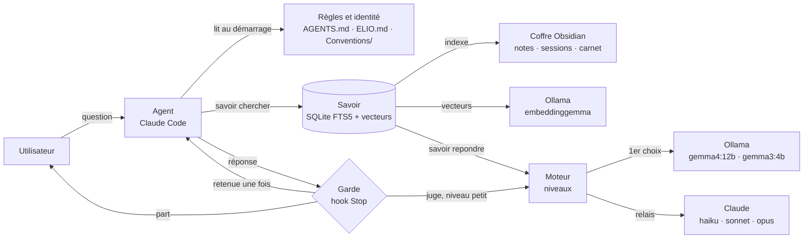

# Élio — agent IA personnel, local d'abord

> **EN —** Élio is a personal AI agent whose identity, rules and memory live in plain Markdown files (an Obsidian vault). The model reading them is a replaceable part: a router sends each request to a *level* (`local`, `small`, `medium`, `large`) served by local models through Ollama first, with Claude as fallback. A local SQLite FTS5 + embeddings index returns short, dated, sourced passages instead of re-reading whole files, and a guard re-reads every answer before it is sent. This repository is the public core of the agent I use every day; personal data, accounts and automations are left out.

Élio est l'agent IA que j'utilise chaque jour pour mes études, mes projets et mon organisation. Il vit dans un coffre Obsidian et dans le terminal ; il tourne sur Claude Code pour le travail avec outils, et sur des modèles locaux servis par Ollama pour tout ce qui peut rester sur la machine.

Ce dépôt en est le **noyau public** : le code réel des trois briques qui le font fonctionner, avec ses tests, et un coffre d'exemple fictif pour le lancer sans aucune donnée personnelle.

## L'idée

Un agent, c'est d'abord **des fichiers et des règles** ; le modèle qui les lit est une pièce qu'on change.

- **L'identité et les règles** sont du Markdown : `AGENTS.md` (ce que tout agent doit savoir), `ELIO.md` (la voix), `Conventions/comportement.md` (chaque règle née d'une correction de l'utilisateur, datée). Claude, Codex, Gemini ou un modèle local lisent les mêmes fichiers et deviennent le même Élio.
- **La mémoire** est le coffre lui-même. Elle n'est jamais relue en entier : une question rend quelques passages courts, datés, avec leur fichier et leur ligne.
- **Le modèle** est choisi par niveau, pas par nom. Le code demande `local` ou `petit` ; un fichier de réglages dit quels moteurs servent ce niveau, et dans quel ordre.

## Architecture



Détail des choix : [docs/architecture.md](docs/architecture.md).

### 1. Savoir — la mémoire ([`elio/savoir.py`](elio/savoir.py))

Un index local de tout ce qu'Élio peut savoir, sans modèle distant et sans quota.

- **Découpage** : un passage par section Markdown, avec son fil de titres (`Note › Projet › État`) ; les lignes-fleuves sont recoupées en fin de phrase.
- **Recherche hybride** : BM25 sur SQLite FTS5 (titre compté triple), fusionné avec la proximité de sens calculée par un modèle d'embedding local (`embeddinggemma` via Ollama, 256 premières dimensions). Un passage premier dans l'un des deux classements ressort même s'il est quelconque dans l'autre.
- **Ce qui fait foi pèse plus que ce qui raconte** : une règle ou une note de contexte passe avant un journal, un journal avant une transcription ; à texte égal, le plus récent gagne (demi-vie de 120 jours).
- **Incrémental** : seuls les fichiers modifiés sont relus ; un passage inchangé garde son vecteur.
- **Sécurité** : ce qui ressemble à une clé est masqué avant d'entrer dans l'index ; un projet réservé (`ELIO_RESERVE`) n'y entre jamais ; la base est créée en `0600`, hors du coffre.
- **Mesurable** : `savoir evaluer` rejoue un jeu de questions et compte celles dont la réponse attendue ressort. Option `avant` : ce qu'Élio savait avant une date, pour rejouer un cas passé sans connaître la suite.

Pourquoi cette brique : dans la version privée, **83 % des tokens consommés venaient du contexte relu à chaque appel**, pas des réponses (mesure du 16/11/2026). Rendre trois passages au lieu de trois fichiers est le premier levier.

### 2. Moteur — le routeur de modèles ([`elio/moteur.py`](elio/moteur.py), [`moteurs.json`](moteurs.json))

| Niveau | Sert à | Moteurs, par ordre de préférence |
|---|---|---|
| `local` | répondre à partir de la mémoire, sans réseau | `ollama:gemma4:12b`, `ollama:gemma3:4b` |
| `petit` | juger, trier, résumer | `claude:haiku`, `ollama:gemma4:12b` |
| `moyen` | rédiger | `claude:sonnet`, `ollama:gemma4:12b` |
| `grand` | raisonner longuement | `claude:opus`, `claude:sonnet` |

Si le premier moteur échoue (quota, connexion expirée, panne, délai), le suivant prend le relais ; le moteur en échec est mis au repos quelques minutes pour ne pas faire attendre chaque appel. Chaque appel est journalisé (moteur, durée, relais, tokens réels quand le moteur les donne). Un nouveau fournisseur se branche sans code : une commande qui lit la question sur l'entrée standard et rend la réponse sur la sortie (`commande:<nom>`).

Claude est lancé **sans outils, sans hooks, sans serveur MCP et hors du coffre** : une demande de texte ne peut rien toucher.

### 3. Garde — la relecture ([`elio/garde.py`](elio/garde.py))

Un hook *Stop* de Claude Code : à la fin de chaque tour, un petit modèle relit la réponse d'Élio et la lui renvoie **une fois** s'il y trouve une faute nette.

Elle est née d'une mesure : un banc de **364 cas réels** tirés de mon historique (corrections, refus, répétitions) montrait qu'un reproche ne baissait pas malgré les règles écrites — Élio me renvoyait des actions qu'il pouvait faire lui-même. Sur un jeu de référence de **170 échanges** (60 tirés des familles fautives, 110 au hasard), étiquetés sur le seul texte de la réponse par deux relecteurs IA indépendants (deux sessions Claude Sonnet séparées, d'accord sur 156 cas sur 170), la garde retient à tort 6 réponses saines sur 142 (**4 %**) et attrape **les 4 renvois nets** sur lesquels les deux relecteurs s'accordent, 8 sur 10 en comptant ceux qu'un seul voit. L'échantillon de fautes est petit : ces chiffres disent que la garde gêne peu, pas qu'elle attrape tout. Une seconde famille (« affirmé sans vérifier ») est jugée et journalisée, mais ne bloque pas : ses fausses alertes étaient trop nombreuses.

Elle ne retient jamais un job automatique, jamais deux fois le même tour, et laisse passer au moindre incident.

## Démarrage rapide

Prérequis : Python 3.9 ou plus récent (bibliothèque standard seulement). Facultatif : [Ollama](https://ollama.com) pour les modèles locaux, [Claude Code](https://docs.claude.com/en/docs/claude-code) pour les niveaux distants.

```bash
git clone https://github.com/keluopro/elio-agent && cd elio-agent

# modèles locaux (facultatif : sans eux, la recherche par les mots fonctionne seule)
ollama pull embeddinggemma && ollama pull gemma4:12b

# indexer le coffre d'exemple, puis interroger la mémoire
python3 -m elio savoir indexer
python3 -m elio savoir chercher "combien de mémoire pour le serveur"
python3 -m elio savoir repondre "quel modèle local utiliser par défaut et pourquoi ?"

# mesurer la recherche sur le jeu de questions d'exemple
python3 -m elio savoir evaluer exemple/questions.jsonl

# quels moteurs répondent, niveau par niveau
python3 -m elio moteur etat

# la garde sur une réponse fautive
echo "Lance toi-même ./sauvegarde.sh et dis-moi ce qu'il affiche." | python3 -m elio garde essai

# tests
python3 -m unittest discover -s tests
```

Sortie réelle de `savoir repondre` sur le coffre d'exemple, entièrement en local (Mac Apple M5, 24 Go) :

```text
Le modèle local par défaut est gemma4:12b, tandis que gemma3:4b reste en secours. Cette décision a été
prise après une comparaison sur 40 questions réelles où gemma4:12b a trouvé la bonne réponse 34 fois
contre 27 pour gemma3:4b. [1][2]
  [1] 08_Archive/sessions/session_2026-11-10_1430.md:4 (2026-11-10)
  [2] memoire_courte.md:11 (2026-11-14)
  — répondu par ollama:gemma4:12b, sans quota
```

### Utiliser son propre coffre

```bash
export ELIO_COFFRE=~/chemin/vers/mon-coffre      # le coffre Obsidian à indexer
export ELIO_SAVOIR_DB=~/.local/share/elio/savoir.db
export ELIO_ECHANGES=1                           # facultatif : indexer aussi les transcriptions Claude Code
export ELIO_RESERVE=Mon_Projet_Secret            # facultatif : un dossier qui n'entre jamais dans l'index
```

Brancher la garde dans Claude Code : voir [`exemple/claude-settings.json`](exemple/claude-settings.json).

## Ce qui tourne en privé, et n'est pas publié

Le noyau ci-dessus sert une série d'automates qui dépendent de mes comptes et de mes données. Ils restent privés ; ils sont décrits ici pour l'architecture.

- **Veille** : six passages par jour, Élio lit mémoires, agenda, mails et web, écrit dans son carnet, et un juge décide si un message mérite de me déranger.
- **Sentinelle** : un relevé de cinq sources toutes les 10 minutes, avec alerte immédiate pour l'urgent.
- **Rêve** : chaque nuit, la consolidation des sessions du jour, le tri des boucles ouvertes et la préparation du réveil des agents.
- **Vigie** : toutes les 10 minutes, elle surveille les autres automates et prévient après trois constats mauvais de suite, avec la cause.
- **Sauvegarde** : un instantané du coffre toutes les heures, hors du service de synchronisation, sans secret, et une copie sur un serveur.
- **Discord et compagnon** : Élio répond aussi sur Discord depuis un conteneur Debian, et une petite app macOS affiche son état au-dessus des sessions d'agents.

En tout, la version privée compte une quarantaine de modules Python et plus de 500 tests.

## Pourquoi local

Élio lit mes notes, mon agenda, mes mails et mes échanges : ce sont des données personnelles. L'exécution locale les garde sur ma machine, rend la mémoire disponible sans réseau ni quota, et laisse le cloud aux seules tâches qui ont besoin d'un raisonnement plus long. Le routeur rend ce partage explicite : changer la frontière entre local et distant, c'est modifier une ligne de `moteurs.json`.

## Limites connues

- La racine des mots est volontairement grossière (troncature) : elle suffit en français pour rapprocher les formes d'un mot, pas pour une langue très fléchie.
- La recherche par le sens parcourt tous les vecteurs en Python : rapide jusqu'à quelques dizaines de milliers de passages, pas au-delà sans index vectoriel.
- Le coffre d'exemple est fictif et petit ; ses chiffres illustrent le format, pas une mesure.
- Code et commentaires sont en français : c'est la langue dans laquelle Élio travaille.

## Sécurité

Ce que le code garantit et ce qu'il ne garantit pas (modèles sans outils, garde qui laisse passer au moindre incident, données envoyées aux moteurs distants) : [SECURITY.md](SECURITY.md).

## Licence

MIT — voir [LICENSE](LICENSE). Claude, Ollama, Gemma, Obsidian et Claude Code sont cités comme outils compatibles ; ce dépôt n'en redistribue ni le code ni les poids, et n'est affilié à aucun de leurs éditeurs.
